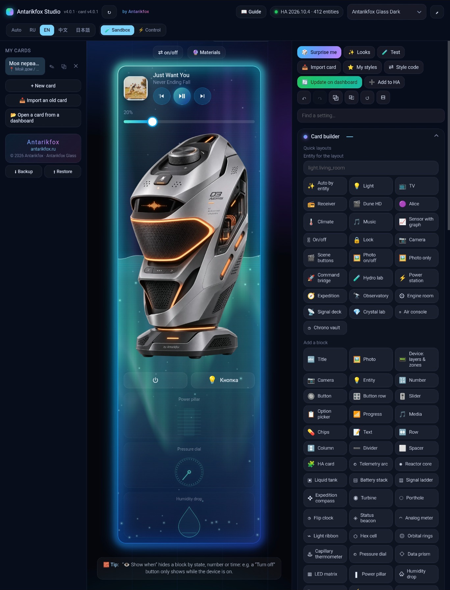
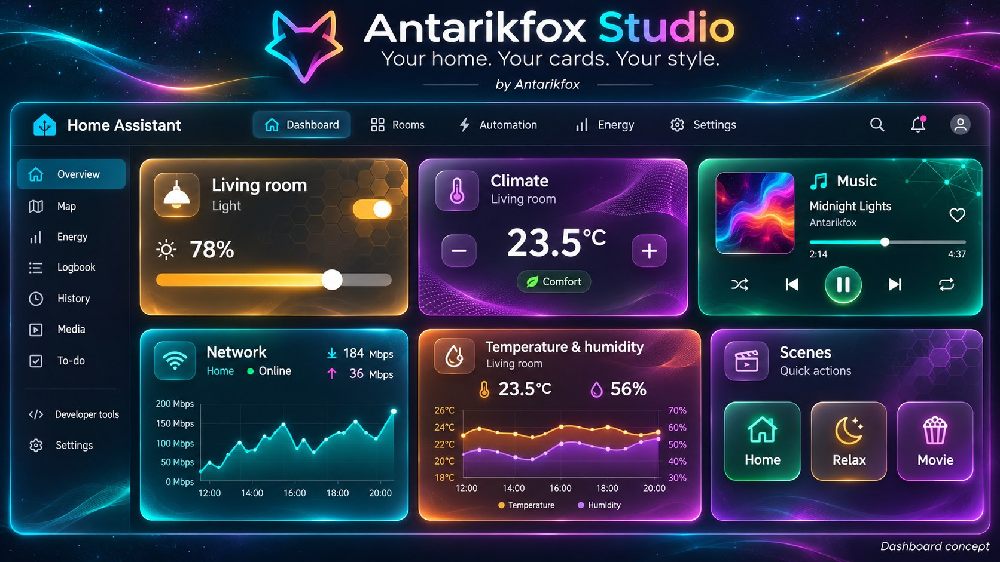
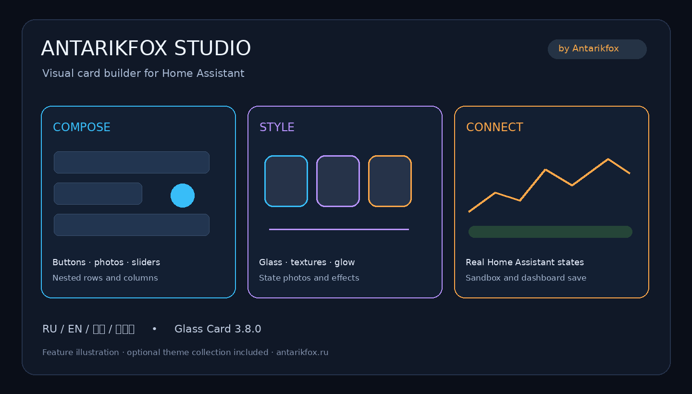

# Antarikfox Studio

**Your home. Your cards. Your style. · by Antarikfox**



*Actual Studio 4.0.1 interface: a custom device card, live media controls, instrument blocks and the visual editor. Browser chrome cropped out.*

Turn a familiar Home Assistant dashboard into your own glass control panel.
Combine translucent surfaces, three-color edge lighting, animated textures and
photos that change with your devices — then arrange the controls in the visual Studio.



*Illustrative dashboard concept. This is generated artwork, not a screenshot or a
ready-to-import dashboard; exact appearance depends on your card settings.*

**Свет, климат, музыка и датчики — в твоём оформлении.** Собирай карточки в визуальном
редакторе: настраивай стекло, цветные края, текстуры, фотографии и действия.
Предпросмотр помогает подобрать оформление перед сохранением в Home Assistant.

Includes **Antarikfox Glass Card 4.0.1**, the **Studio editor**, and an optional theme
collection. Interface languages: **Русский · English · 中文 · 日本語**.

[Install with HACS](#install-with-hacs) · [First card](#first-card) ·
[Русское руководство](docs/GUIDE-RU.md)

## New in 4.0.1

- 10 additional layouts, 30 native instrument blocks, 20 looks and 20 animated textures.
- Layered device graphics, interaction zones, materials and an X-ray view.
- Single tap, double tap and hold actions; double tap does not execute the single-tap action first.
- A fully transparent surface with a fine edge and whole-instrument scaling.
- One language selector in Studio, an embedded glass-fox favicon and consistent full-screen navigation.
- Photo uploads use only Home Assistant's authenticated Image Upload API. No File editor internal API, Supervisor ingress sessions or public photo-folder fallback.

[Release notes](docs/RELEASE-4.0.1.md)

## Make every card your own

| Layer | What you can customize |
| --- | --- |
| Glass & light | Transparency, blur, three-color lighting and 12 color presets |
| Surface | Frost, carbon, hexagons, circuits and animated textures |
| Content | Buttons, sliders, photos, cameras, graphs, media controls and nested groups |
| Device states | Entity values, visibility rules and state-dependent photos |
| Interaction | Single tap, double tap, hold and device interaction zones |
| Workflow | Visual editing, YAML import/export, local backups and storage dashboard saves |

Use warm amber for lighting, cool cyan for network sensors, purple for climate,
or choose your own palette for each card.

<details>
<summary>Studio feature overview</summary>



*Feature illustration, not a Home Assistant screenshot.*

</details>

## Install with HACS

Until the catalog submission is accepted, add
`https://github.com/Antarikfox/Antarikfox-HA-card-Studio` as a **Dashboard** custom repository
in HACS, then download **Antarikfox Studio**.

The `dist` directory contains all installation files; keep the HTML and JS together.
If HACS has not registered the resource automatically, add this JavaScript module
under Settings → Dashboards → Resources (advanced mode may be required):

```text
/hacsfiles/Antarikfox-HA-card-Studio/antarikfox-glass-card.js
```

Reload the browser. Open Studio on the same Home Assistant address at:

```text
/hacsfiles/Antarikfox-HA-card-Studio/antarikfox-studio.html
```

For example, append that path to the address you already use for HA.
A webpage dashboard can point to this path. Studio attempts to reuse your HA session;
if authentication is unavailable, use its connection dialog.

### Optional themes

HACS installs this repository as a Dashboard plugin, **not as a Theme repository**.
Copy the bundled `antarikfox_glass.yaml` from
`/config/www/community/Antarikfox-HA-card-Studio/` to `/config/themes/`.
Merge the following into your existing `frontend` configuration (do not duplicate it):

```yaml
frontend:
  themes: !include_dir_merge_named themes
```

Restart HA after first configuring themes; later changes can use
`frontend.reload_themes`. Select an Antarikfox Glass theme in your profile.
Install **card-mod** through HACS for the additional styling described in the guide.
The custom card and Studio can be used without the optional themes.

## First card

```yaml
type: custom:antarikfox-glass-card
preset: cyber
entity: light.example
content:
  padding: 16
  gap: 12
  blocks:
    - type: title
      entity: light.example
    - type: button
      entity: light.example
      icon: mdi:power
      tap_action:
        action: toggle
```

Replace `light.example` with one of your own entities. Open the visual card editor
or Studio to choose layouts, photos, effects and actions.

## Features

- Compose cards from buttons, sliders, photos, cameras, graphs, media controls and groups.
- Preview real entity states; sandbox mode is enabled by default.
- Import existing card configurations, export YAML, back up Studio cards locally.
- Add cards to storage dashboards, update them in place and undo the latest save.
- Set visibility rules, photo variants, typography, textures and seasonal effects.

YAML-managed and automatic dashboards cannot be edited through Studio's storage
saving flow. Export YAML and edit those dashboards manually. Other custom cards
embedded in a layout must be installed separately.

## Manual installation

Copy all three files from `dist/` to `/config/www/` (put the theme in
`/config/themes/` if needed). Register `/local/antarikfox-glass-card.js?v=4.0.1`
as a JavaScript module and open `/local/antarikfox-studio.html` from HA.

## Русская инструкция

[Полное руководство, настройки и примеры](docs/GUIDE-RU.md).

Через HACS добавляй репозиторий в категории **«Панель / Dashboard»**.
Studio открывается по адресу `/hacsfiles/Antarikfox-HA-card-Studio/antarikfox-studio.html`
на том же сервере, где работает Home Assistant. Тема устанавливается отдельно
копированием YAML — установка карточки через HACS сама тему не активирует.

## Photo uploads

Upload JPEG, PNG, GIF or another browser-decodable image from the editor. Still
images are resized to 1200 px; WebP and other still formats are converted to PNG
for the Home Assistant API, preserving transparency. JPEG stays JPEG and GIF is
kept unchanged. Upload requires an authenticated Home Assistant connection.
If it fails, the file is offered as a local download and the current image URL
is kept. No server URL is invented for the downloaded file.

Previously uploaded public-folder photos are not moved or deleted automatically.
Re-upload personal photos through the editor, verify the new image URLs, then
remove only the old photo files yourself if needed. Home Assistant manages the
new image IDs and serving behavior; this is not a promise of authenticated reads.

## Privacy and security

Studio runs in your browser and connects to the Home Assistant server you select.
Manual tokens, card configurations and backups are stored in this browser's local
storage. Clear the token in the connection dialog when using a shared device.
Treat dashboard backups and exported configurations as potentially private.
Do not post tokens or private dashboard exports in issues.

Optional web fonts are fetched from Google Fonts. Studio can fetch Material Design
icons from jsDelivr. These services receive normal browser requests; local fallback
fonts and icons may differ when offline. Live mode sends actual device commands;
Studio requests confirmation when enabling it. Dashboard saves modify HA configuration.

## Support and license

[Report a bug](https://github.com/Antarikfox/Antarikfox-HA-card-Studio/issues)
with browser and HA versions, reproduction steps and a redacted configuration.

MIT © 2026 Antarikfox · [antarikfox.ru](https://antarikfox.ru)
